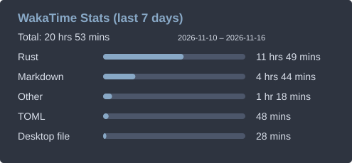

    <h2>Hi, I'm Opynicus 👋</h2>

    <h4>🧩 Coding with</h4>
    

        
        
    

    <h4>🔨 Working with</h4>
    

        
        
        
    

    

        
        
        
    

    <h4>💻 Developing on</h4>
    

        
        
        
        
    

    <h4>🔭 Status</h4>
    
Coding activity over the last 7 days

    

        
    

